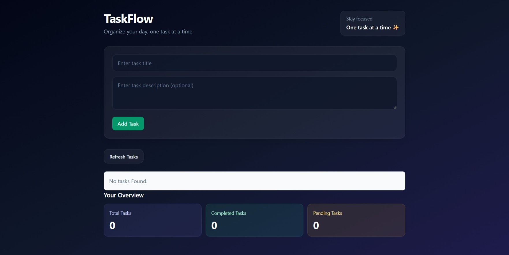
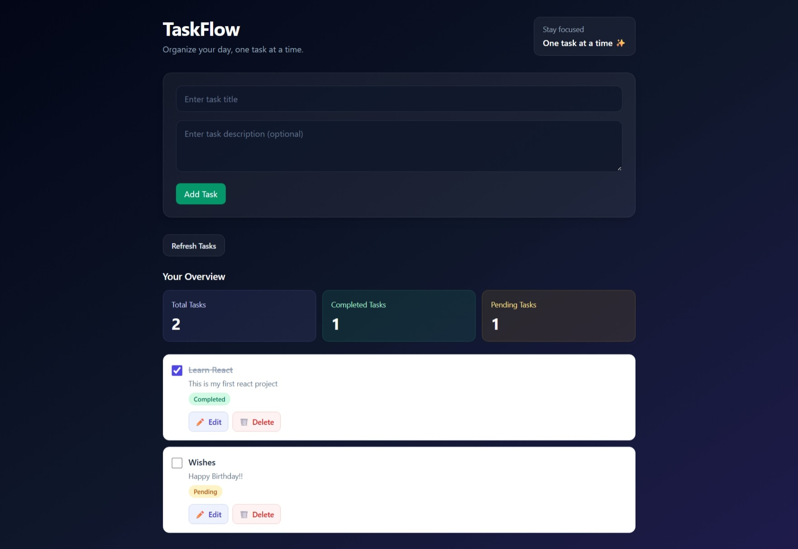

# TaskFlow — React Todo List App

TaskFlow is a Todo List web application built using React and Tailwind CSS. I developed this project to practice React, API integration, and CRUD operations using FreeAPI for task management.

##  Features

- Create new tasks
- View all tasks
- Edit task titles and descriptions
- Delete tasks
- Mark tasks as completed or pending
- Dashboard displaying total, completed, and pending task counts
- Modern and responsive user interface

##  Technologies Used

- React
- JavaScript
- Tailwind CSS
- FreeAPI REST API
- Fetch API
- Git and GitHub
- Vite

##  Backend & API Integration

I learned about FreeAPI through a YouTube tutorial, cloned the tutorial creator's FreeAPI backend project from GitHub, and ran it locally to explore its functionality.

I then developed this React frontend to practice API integration and CRUD operations. The current frontend uses the hosted FreeAPI service to retrieve and manage Todo List data.

- **API Provider:** [FreeAPI](https://freeapi.app/)
- **API Documentation:** [FreeAPI API Docs](https://api.freeapi.app/)
- **API Base URL:** `https://api.freeapi.app/api/v1/todos/`

### API Operations

- **GET:** Retrieve tasks
- **POST:** Create new tasks
- **PATCH:** Update task details and completion status
- **DELETE:** Delete tasks

##  Run Locally

### Prerequisites

- Node.js and npm
- Git

### 1. Clone this repository

```bash
git clone https://github.com/maramsahithi-fs/react-todo-list.git
```

### 2. Open the project folder

```bash
cd react-todo-list
```

### 3. Install dependencies

```bash
npm install
```

### 4. Start the development server

```bash
npm run dev
```

Open the local URL displayed in your terminal, usually `http://localhost:5173`.

##  Screenshots

### 1. Empty Dashboard

Displays the initial state of the application when no tasks are available.




### 2. Task Management Dashboard

Displays completed and pending tasks, task descriptions, and task statistics.



##  Learning Resources & Acknowledgements

I learned React and explored API integration through this YouTube tutorial. The tutorial also introduced me to FreeAPI. I cloned and ran the FreeAPI backend locally to understand how it works, then used the API while developing this Todo List frontend.

I customized the dashboard UI and added task statistics to practice my React skills.

- **React Learning Resource & Tutorial:** [Watch the YouTube tutorial](https://youtu.be/KqGze7HCTIA)
- **Backend API:** [FreeAPI](https://freeapi.app/)

Thanks to the tutorial creator for the learning resource and to FreeAPI for providing the API used in this project.

##  Author

**Maram Sahithi**

GitHub: [maramsahithi-fs](https://github.com/maramsahithi-fs)
